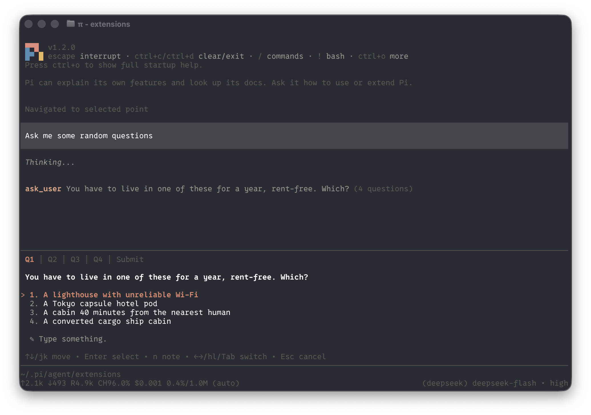

# ask-user

`ask_user` lets the agent ask you questions instead of guessing.

## What the user sees



## What the model sees

**Tool definition** (request payload):

```json
{
  "name": "ask_user",
  "description": "Ask user questions. Provide distinct options, with the recommended one first; set multiSelect when options are not mutually exclusive. Omit options for a free-text question.",
  "parameters": {
    "type": "object",
    "required": ["questions"],
    "properties": {
      "questions": {
        "type": "array",
        "items": {
          "type": "object",
          "required": ["question"],
          "properties": {
            "question": {
              "type": "string",
              "maxLength": 300
            },
            "options": {
              "type": "array",
              "maxItems": 4,
              "items": {
                "type": "string",
                "maxLength": 150
              }
            },
            "multiSelect": {
              "type": "boolean",
              "default": false
            }
          }
        }
      }
    }
  }
}
```

**System prompt guidance** — this extension's contribution, alongside the other tools in the session:

```
Available tools:
- ask_user: Ask the user questions

Guidelines:
- Surface uncertainty or ambiguity. Whenever missing user input blocks progress, use ask_user to ask rather than guess.
```

## Install

```bash
pi install npm:@zjie-wang/pi-ask-user
```
