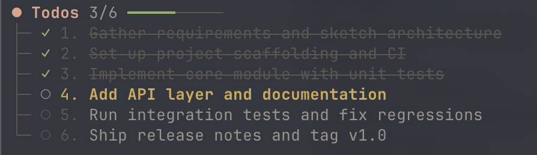

# todo

A todo tracker lives in the session.

## What the user sees



## What the model sees

**Tool definition** (request payload):

```json
{
  "name": "todo",
  "description": "Track complex work in phases.",
  "parameters": {
    "type": "object",
    "required": ["action"],
    "properties": {
      "action": {
        "type": "string",
        "enum": ["set", "update"],
        "description": "set creates or replaces the tracker and activates its first phase; update completes and/or activates phases."
      },
      "items": {
        "type": "array",
        "items": { "type": "string" },
        "description": "Ordered phase titles. Required for set."
      },
      "completeIds": {
        "type": "array",
        "items": { "type": "integer" }
      },
      "activateIds": {
        "type": "array",
        "items": { "type": "integer" }
      }
    },
    "additionalProperties": false
  }
}
```

**System prompt guidance** — this extension's contribution, alongside the other tools in the session:

```
Available tools:
- todo: Track multi-phase progress

Guidelines:
- Use todo for complex work with 3+ meaningfully coordinated phases. Once a tracker is set, remember to update it in real time.
```

## Install

```bash
pi install npm:@zjie-wang/pi-todo
```
